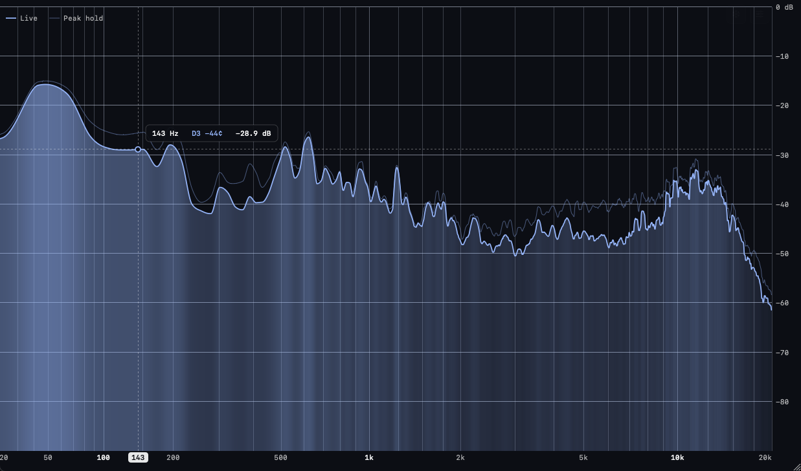
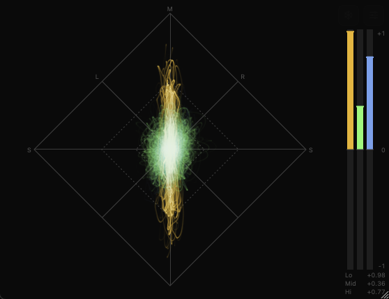

<picture>
  <source media="(prefers-color-scheme: dark)" srcset="assets/brand/p31-logo/readme/p31-lockup-dark.svg">
  
</picture>

# p31-plugins

A spectrum analyzer and a vectorscope for macOS, as CLAP, VST3 and Audio Unit
plugins and standalone apps. Ported from the foobar2000 components in
[fb2k-components-mac-suite](https://github.com/JendaT/fb2k-components-mac-suite).
Audio passes through untouched, with zero latency.

Status: 0.1.0, macOS 12+ (Apple silicon and Intel). There is no signed release
yet: build from source, or take the unsigned installer from a CI run (see
Releases).

## P31 Spectrum



- Live curve and peak hold, or bars; color bars that brighten where the
  spectrum is loud
- Hover readout: frequency, nearest note with cents, and level
- Overlapping windowed FFT (1024 to 32768 points, Hann or Blackman-Harris),
  vDSP with a pffft fallback
- Log, compact-bass log or linear frequency axis; adjustable slope (2 dB/oct
  by default), range and smoothing (RMS or attack / decay)
- Mid + side display; vertical layout

## P31 Scope



- Goniometer (mid / side) or Lissajous (left / right) with phosphor afterglow
- Trace in one colour or split into low / mid / high bands
- Correlation meter, single or per band, with a held range of recent swings
- Auto gain, adjustable afterglow, brightness and crossovers

## Using the plugins

- **Settings**: hover over the editor and click the sliders icon (top right), or
  right-click anywhere. Everything is saved with the project. Right-click →
  About shows the version and licenses.
- **Presets**: the Presets button on the settings page (or the right-click
  menu) has factory presets, your own presets (saved in
  `~/Library/Audio/Presets/P31/<plugin>/`) and "Use Current Settings for New
  Instances". Loading a preset keeps the instance's light / dark appearance.
- **Parameters** (automatable): *Freeze* holds the picture still, *Gain*
  (±24 dB) changes the level the analyzer sees. Audio always passes through
  untouched.
- **Readout** (P31 Spectrum): hover over the spectrum for the frequency, the
  nearest note with its offset in cents, and the level.
- **Themes**: P7 blue (Spectrum's default), P31 green, P3 amber and P4 white,
  named after CRT phosphors, plus more colour presets.
- **Appearance**: follow the system, or fixed light or dark per instance.
- **Size**: drag the grip in the bottom-right corner. The size is saved with
  the project.

## Install

Run `P31-Plugins-<version>.pkg` (from a GitHub release once there is one, a CI
run's artifacts, or `scripts/package.sh`). "Customize" picks the formats:

| Choice | Installs to |
|---|---|
| CLAP | `/Library/Audio/Plug-Ins/CLAP` |
| VST3 | `/Library/Audio/Plug-Ins/VST3` |
| Audio Unit | `/Library/Audio/Plug-Ins/Components` |
| Standalone apps | `/Applications` |

To uninstall, delete `P31 Spectrum.*` and `P31 Scope.*` from those folders, then
`pkgutil --pkgs | grep com.scannou.p31 | xargs -n1 sudo pkgutil --forget`.

## Requirements

- macOS 12+ (builds universal arm64 + x86_64)
- Xcode command line tools, CMake 3.25+, Ninja: `brew install cmake ninja`
- For validation: pluginval (`brew install --cask pluginval`)

## Build

```sh
scripts/bootstrap.sh          # submodules + clap-validator into tools/
cmake --preset dev            # Debug, native arch, build/dev
cmake --build --preset dev
```

`cmake --preset release` builds Release universal binaries into `build/release`.

Bundles land in `<build>/plugins/`. With `P31_COPY_AFTER_BUILD=ON` (default for
`dev`) they are also copied to `~/Library/Audio/Plug-Ins/{CLAP,VST3,Components}`.

In CLion: open the folder, enable the `dev` CMake preset, build `p31-spectrum_all`
or `p31-scope_all`.

## Test

```sh
ctest --preset dev                                   # core unit tests (doctest)
cmake --preset tsan && cmake --build --preset tsan && ctest --preset tsan
cmake --preset asan && cmake --build --preset asan && ctest --preset asan
```

## Look at an editor without a DAW

```sh
build/dev/dev/p31-snapshot "build/dev/plugins/P31 Scope.clap" scope.png mix 2
```

Loads the plugin, opens its editor, plays a test signal for the given seconds
and saves the editor as PNG. Signals: `mix`, `mono`, `left`, `wide`, `antiphase`,
`silence` (for the scope), `sine`, `tones`, `white` (for the spectrum), or
`file:<path>` with raw stereo float32 audio at 48 kHz
(`ffmpeg -i song.wav -f f32le -ac 2 -ar 48000 song.f32`). Optional width and
height follow the seconds; a trailing `settings [scroll]` opens the settings
page.

| Variable | Effect |
|---|---|
| `P31_STATE=<file>` | load settings text (`key=value` lines) as the plugin state first |
| `P31_SELECT=<item>` | pick that item in a settings pop-up |
| `P31_HOVER=x,y` | put the mouse at that fraction of the editor (hover readout) |
| `P31_DRAG=dx,dy` | drag the resize grip, with the host resizing like a DAW |
| `P31_ABOUT=1` | save the About dialog instead of the editor |
| `P31_DUMP_STATE=1` | print the saved state at the end |

## Validate

```sh
scripts/validate.sh [build-dir]
```

Runs clap-validator, the Steinberg VST3 validator, `auval -strict` and pluginval
(strictness 10, including GUI tests) against both plugins.

## Releases

```sh
scripts/package.sh            # Release build -> dist/P31-Plugins-<version>.pkg
```

Without signing variables the bundles are ad-hoc signed and the package is
unsigned: fine on this Mac, not for anyone else. For a distributable package:

1. In the Apple Developer account, create a **Developer ID Application** and a
   **Developer ID Installer** certificate and install both in the login keychain.
2. Store notarization credentials once:
   `xcrun notarytool store-credentials p31-notary --apple-id <id> --team-id <TEAMID>`
   (with an app-specific password).
3. Build:
   ```sh
   P31_SIGN_ID="Developer ID Application: <Name> (<TEAMID>)" \
   P31_INSTALLER_ID="Developer ID Installer: <Name> (<TEAMID>)" \
   P31_NOTARY_PROFILE=p31-notary scripts/package.sh
   ```

The package is signed, notarized and stapled.

CI (`.github/workflows/ci.yml`) builds, tests, validates and packages every push
and pull request; the unsigned package is attached to each run. Pushing a tag
`v<version>` (matching `project(... VERSION ...)` in CMakeLists.txt) also
publishes a GitHub release:

```sh
git tag v0.1.0 && git push origin v0.1.0
```

Without signing secrets the release carries the unsigned package, and its notes
explain how to open it past Gatekeeper. With these repository settings (they
need a paid Apple Developer account) it is signed and notarized instead:

| Kind | Name | Value |
|---|---|---|
| Variable | `P31_SIGN_ID` | `Developer ID Application: <Name> (<TEAMID>)` |
| Variable | `P31_INSTALLER_ID` | `Developer ID Installer: <Name> (<TEAMID>)` |
| Secret | `DEVELOPER_ID_APP_P12_BASE64` | `base64 -i app.p12` of the exported certificate + key |
| Secret | `DEVELOPER_ID_INSTALLER_P12_BASE64` | the same for the installer certificate |
| Secret | `P12_PASSWORD` | password of both .p12 files |
| Secret | `NOTARY_KEY_P8_BASE64` | `base64 -i AuthKey_XXXX.p8` (App Store Connect API key, Developer role) |
| Secret | `NOTARY_KEY_ID` | the key's ID |
| Secret | `NOTARY_ISSUER` | the issuer ID |

## Layout

```
core/            C++20 DSP; only platform code is the vDSP FFT backend (tests in core/tests)
render/          AppKit views, compiled into each plugin (unique ObjC class names)
plugins/common/  shared CLAP shell (ports, state, pass-through, editor hosting)
plugins/spectrum/
plugins/scope/
dev/             developer tools (p31-snapshot)
cmake/ scripts/  build helpers; bootstrap, validate, package, notices
patches/         fixes to submodules, applied by scripts/bootstrap.sh (see patches/README.md)
.github/         CI
libs/            submodules (CLAP, clap-wrapper, VST3 SDK, AudioUnitSDK, RtAudio, RtMidi, pffft, doctest)
```

## License

MIT, see [LICENSE](LICENSE). Bundled SDKs: CLAP, clap-wrapper and the VST3 SDK (3.8+)
are MIT; Apple's AudioUnitSDK is Apache 2.0; RtAudio and RtMidi use MIT-style licenses;
pffft uses the BSD-style FFTPACK license; doctest (tests only) is MIT.
[THIRD_PARTY_NOTICES.txt](THIRD_PARTY_NOTICES.txt) (regenerate with
`scripts/notices.sh` after updating a submodule) ships inside every bundle and
in the installer.
