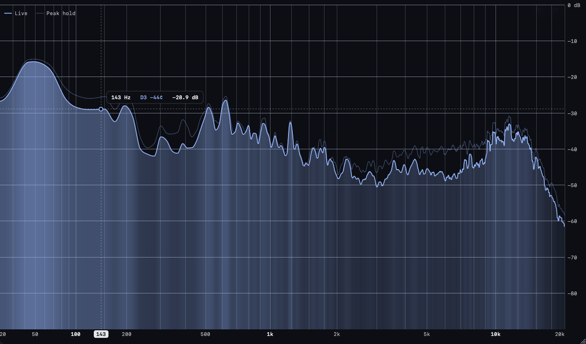
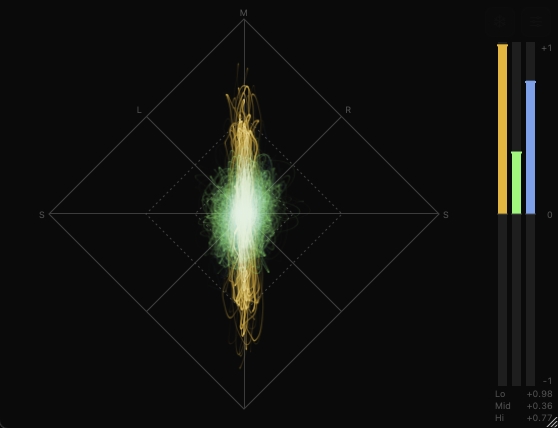
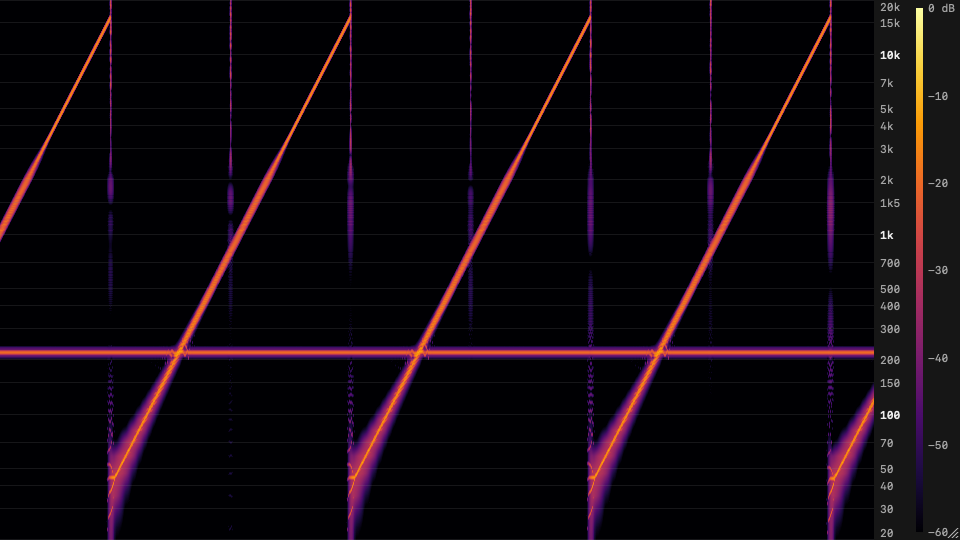
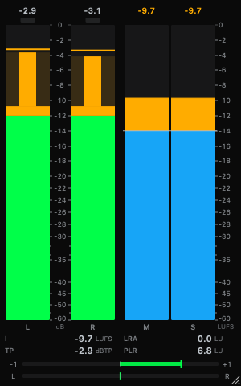
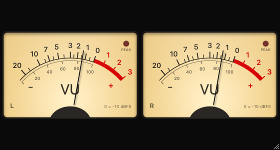
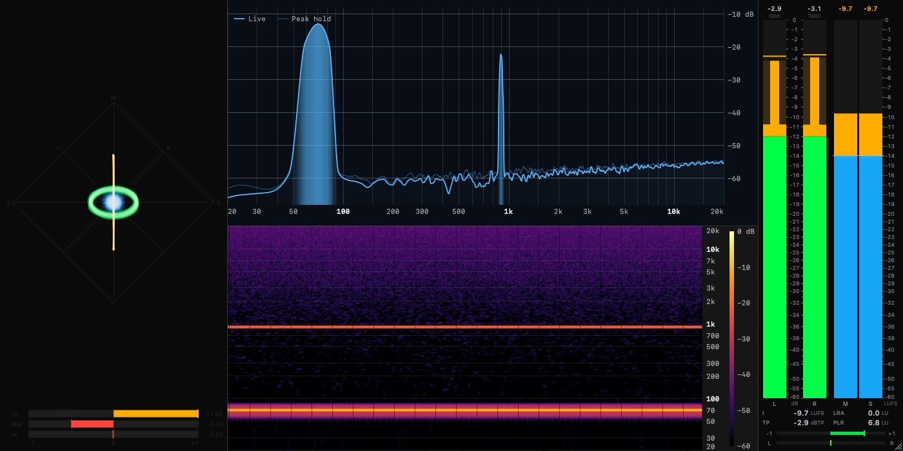

<picture>
  <source media="(prefers-color-scheme: dark)" srcset="assets/brand/p31-logo/readme/p31-lockup-dark.svg">
  
</picture>

# p31-plugins

A spectrum analyzer, a vectorscope, a spectrogram and a level meter for macOS,
as CLAP, VST3 and Audio Unit plugins and standalone apps, plus P31 Suite, which
shows all four in one window. Ported from the foobar2000 components in
[fb2k-components-mac-suite](https://github.com/JendaT/fb2k-components-mac-suite).
Audio passes through untouched, with zero latency.

Status: 0.1.6, macOS 12+ (Apple silicon and Intel). Installers are on the
[Releases](https://github.com/Scannou/p31-plugins/releases) page; they are not
signed yet, and each release's notes explain how to open one.

## P31 Spectrum



- Live curve and peak hold, or bars; color bars that brighten where the
  spectrum is loud
- Hover readout: frequency, nearest note with cents, and level
- Overlapping windowed FFT (1024 to 32768 points, Hann or Blackman-Harris),
  vDSP with a pffft fallback
- Log, compact-bass log or linear frequency axis; adjustable slope (1 dB/oct
  by default), range and smoothing (RMS or attack / decay)
- Auto gain: the top of the display follows the loudest recent level, so
  quiet material fills it too; the dB scale moves with it and keeps showing
  true levels
- Mid + side display; vertical layout

## P31 Scope



- Goniometer (mid / side) or Lissajous (left / right) with phosphor afterglow
- Trace in one colour or split into low / mid / high bands
- Correlation meter, single or per band, with a held range of recent swings
- Auto gain, adjustable afterglow, brightness and crossovers

## P31 Spectrogram



- Frequency over time, level as colour; the picture holds while the host is
  stopped or the display is frozen
- Reassigned analysis (default) keeps tonal lines thin, bass included, while
  kicks stay narrow in time; multi-resolution and standard modes
- Levels in dBFS with adjustable top level, range and slope; mid, left, right
  or side channel
- Auto gain: the top level follows the loudest recent level, so quiet
  material uses the whole colour range; the dB scale moves with it
- Logarithmic, mel or linear frequency axis; vertical or horizontal, the
  horizontal one lining up with P31 Spectrum
- Nine colormaps, a ramp per P31 Spectrum theme, or four colours of your own

## P31 Meter

| Digital | Analog VU |
|---|---|
|  |  |

- L / R bars: RMS as the wide bar, the peak as a slim column above it, a hold
  line, clip lights that stay lit, the highest peak above each bar
- True peak (4x oversampled, as BS.1770 describes) or sample peak; dBFS or
  K-20 / K-14 / K-12 scales, extended-top or linear spacing, LED segments
- Loudness after BS.1770 / EBU R128: momentary and short-term bars with a
  target marker, gated integrated loudness, loudness range, true peak max and
  PLR. It keeps measuring while the plugin window is closed
- Phase correlation and balance bars
- Analog VU style: Vintage, Dark or theme-coloured needle faces, VU ballistics
  or DIN / BBC / Nordic style PPM, adjustable reference level, peak LED
- Click the bars or readouts to reset the peaks, the loudness bars or figures
  to start a new loudness measurement; both are in the right-click menu too,
  with the switch between Digital and Analog VU

## P31 Suite



- The spectrum, the scope, the spectrogram and the meter as panels of one
  window, on the same audio; each panel is the plugin of that name, with its
  own settings and presets
- Drag the line between two panels to resize them
- Hover over a panel and drag its move handle (the arrows, top right) to put
  the panel somewhere else: on a side of another panel, in the middle of one
  to trade places, or along an edge of the window. The place lights up before
  you drop
- The × beside the handle hides a panel; right-click → Panels brings it back.
  A hidden panel does no work (the meter's loudness measurement pauses with
  it)
- Freeze, Gain and the standalone app's Source are shared by all panels

## Using the plugins

- **Settings**: hover over the editor and click the sliders icon (top right), or
  right-click anywhere. They open in a window of their own beside the editor;
  in P31 Suite one window has a tab per shown panel. Everything is saved with
  the project. Right-click → About shows the version and licenses.
- **Presets**: the Presets button on the settings page (or the right-click
  menu) has factory presets, your own presets (saved in
  `~/Library/Audio/Presets/P31/<plugin>/`) and "Use Current Settings for New
  Instances". Loading a preset keeps the instance's light / dark appearance.
- **Parameters** (automatable): *Freeze* holds the picture still, *Gain*
  (±24 dB) changes the level the analyzer sees (in P31 Meter it shifts every
  reading). Audio always passes through untouched.
- **Readout**: in P31 Spectrum, hover over the spectrum for the frequency, the
  nearest note with its offset in cents, and the level. In P31 Spectrogram,
  click and hold for the frequency and nearest note; drag to scrub.
- **Themes**: P7 blue (Spectrum's default), P31 green, P3 amber and P4 white,
  named after CRT phosphors, plus more colour presets. Theme and custom
  colours are drawn in Display P3, at full saturation on wide-gamut screens.
- **Appearance**: follow the system, or fixed light or dark per instance.
- **Size**: drag the grip in the bottom-right corner. The size is saved with
  the project.
- **P31 Suite**: the arrangement of the panels is saved with the project, with
  every panel's settings. Right-click → Panels has "Reset Layout" and "Use
  Current Layout for New Instances". A panel's presets are those of its own
  plugin (a preset saved in P31 Spectrum shows up in the suite's spectrum
  panel and the other way round), and a new suite starts each panel from that
  plugin's settings for new instances.
- **Standalone apps**: they show everything the Mac is playing (macOS 14.2 or
  later; macOS asks once for permission to record system audio). Settings →
  Input → Source switches to an input device instead, the one chosen under
  Audio/MIDI Settings in the app's menu. On older macOS the apps show the
  input device.

## Install

Run `P31-Plugins-<version>.pkg` (from a GitHub release once there is one, a CI
run's artifacts, or `scripts/package.sh`). Its Installation Type step has a box
per plugin and, below them, a box per format, all ticked to begin with. Untick
what you do not want: the ticked plugins are installed in the ticked formats,
so you can install, say, only P31 Spectrum and P31 Meter as VST3 and Audio
Unit:

| Format | Installs to |
|---|---|
| CLAP | `/Library/Audio/Plug-Ins/CLAP` |
| VST3 | `/Library/Audio/Plug-Ins/VST3` |
| Audio Unit | `/Library/Audio/Plug-Ins/Components` |
| Standalone apps | `/Applications` |

To uninstall, delete `P31 Spectrum.*`, `P31 Scope.*`, `P31 Spectrogram.*`,
`P31 Meter.*` and `P31 Suite.*` from those folders, then
`pkgutil --pkgs | grep com.scannou.p31 | xargs -n1 sudo pkgutil --forget`.

## Requirements

- macOS 12+ (builds universal arm64 + x86_64)
- Xcode command line tools, CMake 3.25+, Ninja: `brew install cmake ninja`
- For validation: pluginval (`brew install --cask pluginval`)

## Build

```sh
scripts/bootstrap.sh          # submodules + clap-validator into tools/
cmake --preset dev            # Debug, native arch, build/dev
cmake --build --preset dev
```

`cmake --preset release` builds Release universal binaries into `build/release`.

Bundles land in `<build>/plugins/`. With `P31_COPY_AFTER_BUILD=ON` (default for
`dev`) they are also copied to `~/Library/Audio/Plug-Ins/{CLAP,VST3,Components}`.

In CLion: open the folder, enable the `dev` CMake preset, build `p31-spectrum_all`,
`p31-scope_all`, `p31-spectrogram_all`, `p31-meter_all` or `p31-suite_all`.

## Test

```sh
ctest --preset dev                                   # core unit tests (doctest)
cmake --preset tsan && cmake --build --preset tsan && ctest --preset tsan
cmake --preset asan && cmake --build --preset asan && ctest --preset asan
```

## Look at an editor without a DAW

```sh
build/dev/dev/p31-snapshot "build/dev/plugins/P31 Scope.clap" scope.png mix 2
```

Loads the plugin, opens its editor, plays a test signal for the given seconds
and saves the editor as PNG. Signals: `mix`, `mono`, `left`, `wide`, `antiphase`,
`silence` (for the scope), `sine`, `tones`, `white` (for the spectrum), `sweep`
(for the spectrogram), or
`file:<path>` with raw stereo float32 audio at 48 kHz
(`ffmpeg -i song.wav -f f32le -ac 2 -ar 48000 song.f32`). Optional width and
height follow the seconds; a trailing `settings [scroll]` opens the settings
window and saves that instead of the editor.

| Variable | Effect |
|---|---|
| `P31_STATE=<file>` | load settings text (`key=value` lines) as the plugin state first |
| `P31_TAB=<title>` | with `settings`: pick that tab of the settings window (P31 Suite) |
| `P31_SELECT=<item>` | pick that item in a settings pop-up |
| `P31_HOVER=x,y` | put the mouse at that fraction of the editor (hover readout; held down on the spectrogram) |
| `P31_DRAG=dx,dy` | drag the resize grip, with the host resizing like a DAW |
| `P31_ABOUT=1` | save the About dialog instead of the editor |
| `P31_HOLD=1` | stop the audio a second before the capture, as a stopped DAW does |
| `P31_CLICK=x,y` | click the editor at that fraction (0,0 is top left) just before the capture: resets P31 Meter's bars or figures |
| `P31_DUMP_STATE=1` | print the saved state at the end |

For P31 Suite, where a panel is `Spectrum`, `Scope`, `Spectrogram` or `Meter`:

| Variable | Effect |
|---|---|
| `P31_TOOLBAR=1` | show every panel's toolbar, as with the mouse over it |
| `P31_DIVIDER=n,dx,dy` | drag the n-th line between panels by that many points |
| `P31_MOVE=<panel>,x,y` | drag the panel by its handle to that fraction of the editor (0,0 is top left) and drop it |
| `P31_MOVE_HOLD=1` | with `P31_MOVE`: capture before the drop, with the place lit up |
| `P31_HIDE=<panel>` | click the panel's hide button |
| `P31_PANELS=<item>` | pick that item in right-click → Panels |

## Validate

```sh
scripts/validate.sh [build-dir]
```

Runs clap-validator, the Steinberg VST3 validator, `auval -strict` and pluginval
(strictness 10, including GUI tests) against every plugin.

## Releases

```sh
scripts/package.sh            # Release build -> dist/P31-Plugins-<version>.pkg
```

Without signing variables the bundles are ad-hoc signed and the package is
unsigned: fine on this Mac, not for anyone else. For a distributable package:

1. In the Apple Developer account, create a **Developer ID Application** and a
   **Developer ID Installer** certificate and install both in the login keychain.
2. Store notarization credentials once:
   `xcrun notarytool store-credentials p31-notary --apple-id <id> --team-id <TEAMID>`
   (with an app-specific password).
3. Build:
   ```sh
   P31_SIGN_ID="Developer ID Application: <Name> (<TEAMID>)" \
   P31_INSTALLER_ID="Developer ID Installer: <Name> (<TEAMID>)" \
   P31_NOTARY_PROFILE=p31-notary scripts/package.sh
   ```

The package is signed, notarized and stapled.

CI (`.github/workflows/ci.yml`) builds, tests, validates and packages every push
and pull request; the unsigned package is attached to each run. Pushing a tag
`v<version>` (matching `project(... VERSION ...)` in CMakeLists.txt) also
publishes a GitHub release:

```sh
git tag v0.1.6 && git push origin v0.1.6
```

Without signing secrets the release carries the unsigned package, and its notes
explain how to open it past Gatekeeper. With these repository settings (they
need a paid Apple Developer account) it is signed and notarized instead:

| Kind | Name | Value |
|---|---|---|
| Variable | `P31_SIGN_ID` | `Developer ID Application: <Name> (<TEAMID>)` |
| Variable | `P31_INSTALLER_ID` | `Developer ID Installer: <Name> (<TEAMID>)` |
| Secret | `DEVELOPER_ID_APP_P12_BASE64` | `base64 -i app.p12` of the exported certificate + key |
| Secret | `DEVELOPER_ID_INSTALLER_P12_BASE64` | the same for the installer certificate |
| Secret | `P12_PASSWORD` | password of both .p12 files |
| Secret | `NOTARY_KEY_P8_BASE64` | `base64 -i AuthKey_XXXX.p8` (App Store Connect API key, Developer role) |
| Secret | `NOTARY_KEY_ID` | the key's ID |
| Secret | `NOTARY_ISSUER` | the issuer ID |

## Layout

```
core/            C++20 DSP; only platform code is the vDSP FFT backend (tests in core/tests)
render/          AppKit views, compiled into each plugin (unique ObjC class names)
plugins/common/  shared CLAP shell (ports, state, pass-through, editor hosting)
plugins/spectrum/
plugins/scope/
plugins/spectrogram/
plugins/meter/
plugins/suite/   the other plugins' editors as panels of one window
dev/             developer tools (p31-snapshot)
cmake/ scripts/  build helpers; bootstrap, validate, package, notices, icons
patches/         fixes to submodules, applied by scripts/bootstrap.sh (see patches/README.md)
.github/         CI
libs/            submodules (CLAP, clap-wrapper, VST3 SDK, AudioUnitSDK, RtAudio, RtMidi, pffft, doctest)
```

## License

MIT, see [LICENSE](LICENSE). Bundled SDKs: CLAP, clap-wrapper and the VST3 SDK (3.8+)
are MIT; Apple's AudioUnitSDK is Apache 2.0; RtAudio and RtMidi use MIT-style licenses;
pffft uses the BSD-style FFTPACK license; doctest (tests only) is MIT.
[THIRD_PARTY_NOTICES.txt](THIRD_PARTY_NOTICES.txt) (regenerate with
`scripts/notices.sh` after updating a submodule) ships inside every bundle and
in the installer.
